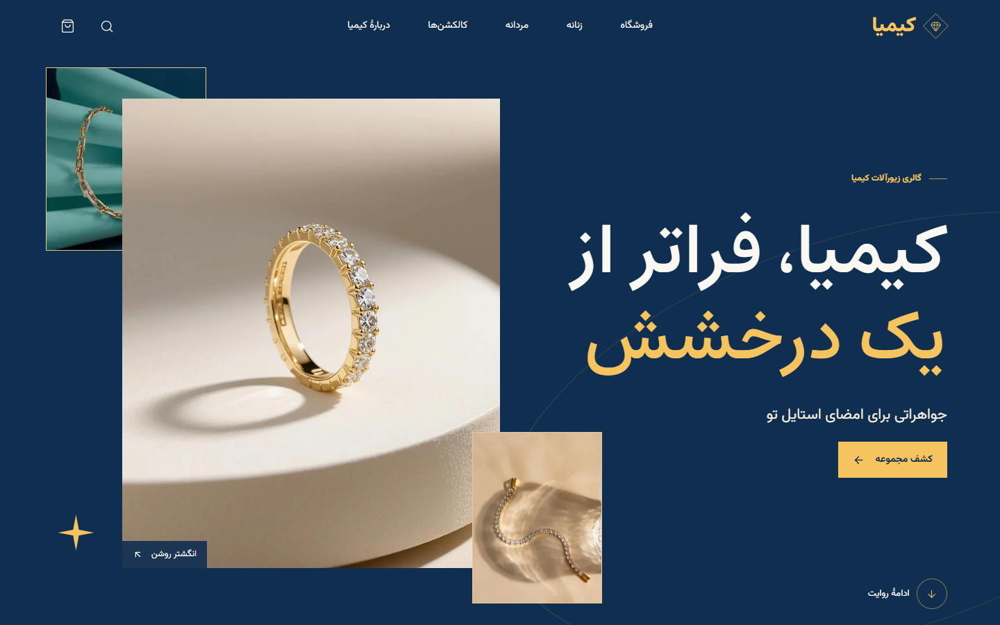
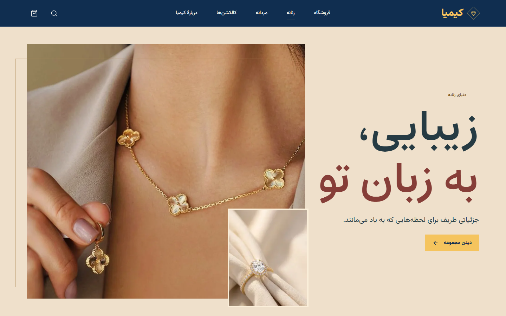
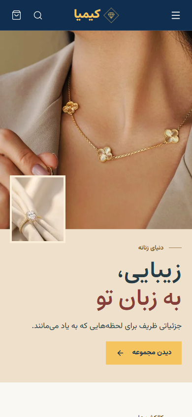
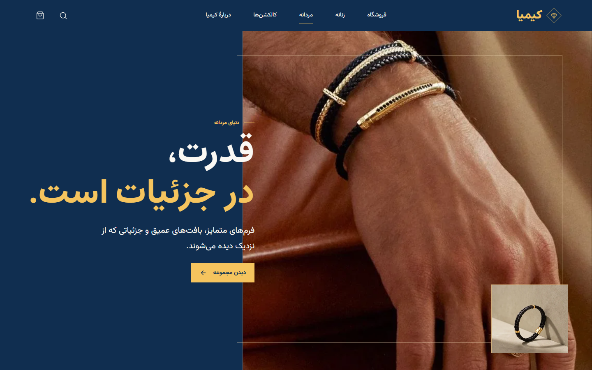
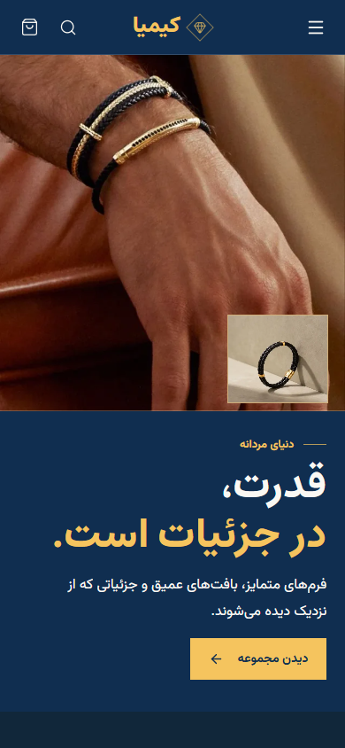
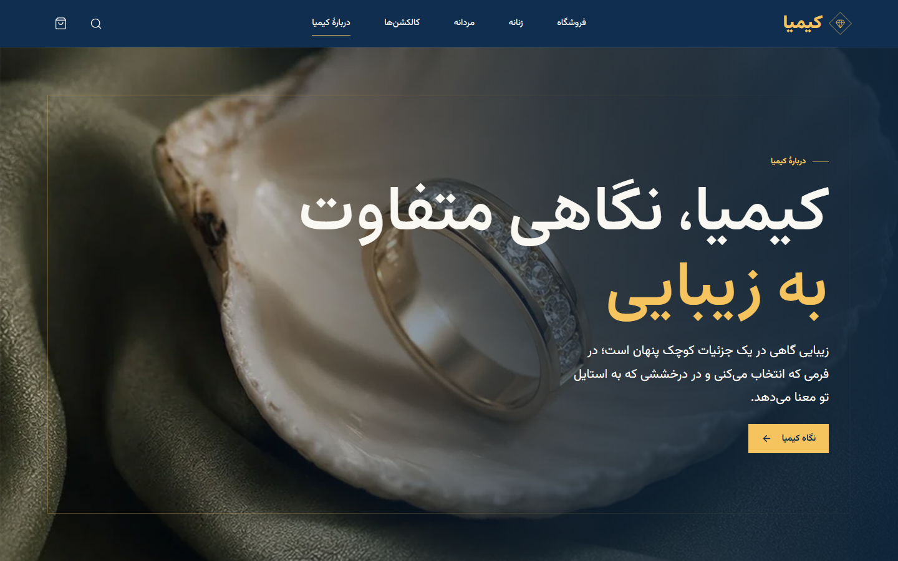
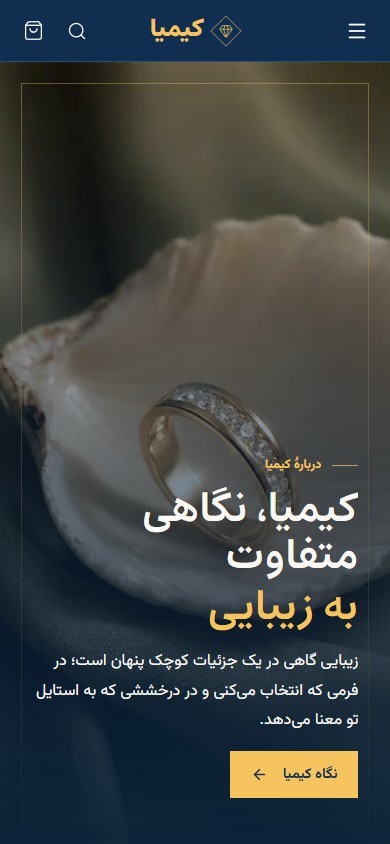

# KIMIA Jewelry

KIMIA is a Persian, right-to-left jewelry storefront built with Next.js. The home, women’s, men’s, and About pages use local jewelry photography and scroll-driven editorial layouts. The project includes a browsable sample catalog and a checkout preview.

## Objectives

- Make it easy to discover jewelry through photography, collection filters, and individual product pages.
- Keep product details and pricing states clear in Persian.
- Provide an expressive desktop experience and a readable, vertically scrolling alternative on touch devices and with reduced motion.
- Make the entire project runnable from the repository using local assets and a locked dependency set.

## Application screenshots

The images below were captured from the running application. The full-page V2 home captures use reduced motion to show every chapter in document order. The separate interaction captures show the active desktop animations.

| Homepage | Interaction |
| --- | --- |
| [Desktop overview](docs/screenshots/homepage-desktop-v2.png) | [Hero at the start](docs/screenshots/hero-scroll-start.png) |
| [Mobile overview](docs/screenshots/homepage-mobile-v2.png) | [Hero mid-scroll](docs/screenshots/hero-scroll-mid.png) |
| [Horizontal runway](docs/screenshots/horizontal-runway.png) | [Pinned product story](docs/screenshots/product-story-mid.png) |
| [Collection transition](docs/screenshots/collection-transition.png) | |



### Women’s collection



<details><summary>Mobile screenshot</summary>



</details>

### Men’s collection



<details><summary>Mobile screenshot</summary>



</details>

### About KIMIA



<details><summary>Mobile screenshot</summary>



</details>

## Key features

- Eight-chapter homepage with three desktop pins and a horizontal product runway.
- Distinct women’s and men’s campaigns, with category links, product studies, horizontal runways, and their full filterable catalogs.
- About page with a brand philosophy, a five-step shopping walkthrough, and links to both pricing filters.
- Persian product search, collection and product-type filters, pricing filters, and sorting for priced items.
- Individual product pages with local photography, image zoom, pricing details, and cart controls.
- Browser-persisted cart and checkout preview.

## Technology stack

| Area | Tools |
| --- | --- |
| Framework | Next.js 16 App Router, React 19, TypeScript |
| Styling | CSS, Tailwind CSS 4 and PostCSS |
| Motion | GSAP, ScrollTrigger, and `@gsap/react` |
| Typography | Local Estedad and Vazirmatn variable fonts from Fontsource |
| Images and icons | Local WebP assets, Next.js Image, Lucide React |
| Tooling | npm lockfile, ESLint, TypeScript compiler |

## Architecture

App Router pages compose server-rendered content and route metadata. Client components handle motion, search and filters, image zoom, and the cart. Editorial sections read from the same product records as the shop and product pages. Styles for the campaigns are separate from shared storefront styles.

```text
.
├── docs/screenshots/          Browser captures referenced by this README
├── public/images/products/    Optimized product photographs
├── src/
│   ├── app/                   Routes, layout, metadata, and CSS
│   ├── components/
│   │   ├── editorial/         Campaign sections and GSAP animation code
│   │   ├── cart-store.tsx     Cart state and browser persistence
│   │   ├── catalog.tsx        Client-side search and filtering
│   │   └── visual.tsx         Shared images, product cards, links, and pricing
│   └── lib/
│       ├── collections.ts     Collection labels and images
│       ├── pricing.ts         Price states and Persian currency formatting
│       └── products.ts       Typed sample product records and image mapping
├── next.config.ts
├── package.json
└── package-lock.json
```

## Application routes

| Route | Purpose |
| --- | --- |
| `/` | Editorial homepage |
| `/women` | Women’s campaign and catalog |
| `/men` | Men’s campaign and catalog |
| `/about` | Brand philosophy, shopping walkthrough, and pricing |
| `/shop` | Full catalog with search, filters, and sorting |
| `/products/[slug]` | Product details |
| `/cart` | Review and edit the cart |
| `/checkout` | Demo checkout preview |
| `/information` | Shopping terms and privacy information |

Collection links can open a category directly, for example `/women?category=ring#collection-catalog`. The shop accepts `?pricing=fixed` and `?pricing=live-gold`. The header search opens `/shop?search=1`.

## Prerequisites

- Git and Node.js **20.9 or newer**, as required by the installed Next.js version. Node.js 24 was used for verification.
- npm, bundled with Node.js. Install dependencies from `package-lock.json` using `npm ci`.

## Local development

Install Node.js for your operating system, then open a terminal in the folder where you want the checkout.

**Windows PowerShell**

```powershell
git clone https://github.com/stupidtallguy/Kimia_Jewelry.git
Set-Location Kimia_Jewelry
npm.cmd ci
npm.cmd run dev
```

**macOS and Linux**

```bash
git clone https://github.com/stupidtallguy/Kimia_Jewelry.git
cd Kimia_Jewelry
npm ci
npm run dev
```

Open [localhost:3000](http://localhost:3000). The development server prints the port it selects. On Windows, use `npm.cmd` in the remaining commands if PowerShell blocks `npm.ps1`.

### Environment variables

The project requires no environment variables. The catalog, fonts, and product photography are local. Private environment files are ignored by Git.

### Production build

```bash
npm run build
npm start
```

The start script serves the generated `.next` build. Run the build again after source changes.

## Testing and verification

```bash
npm run lint
npm run typecheck
npm run build
```

Run the production build before standalone type checking in a fresh clone if generated Next.js declarations are missing. The repository has no automated test script. Browser verification for V3 used Chrome via Playwright and covered the homepage, the three campaigns, all product routes, category links, pricing filters, keyboard focus, back and forward navigation, cart persistence, and checkout. The browser verification tool was run separately from the project dependencies.

## Animation architecture

`src/components/editorial/use-editorial-motion.ts` registers GSAP and ScrollTrigger, scopes animation setup to the mounted page, and reverts the media context when the route changes. It refreshes trigger geometry after fonts and images load. The V2 homepage timelines live in `timelines.ts`. The collection pages and About use `interior-motion.tsx`, and the homepage and collection campaigns share `runway-motion.ts`.

A runway pins below the navigation on suitable desktops. Vertical scroll moves the RTL track and its progress indicator. Keyboard focus brings offscreen cards into view. A short route entrance accompanies normal Next.js navigation and browser history.

## Product and pricing architecture

`src/lib/products.ts` contains 28 sample products with stable IDs, slugs, collection membership, categories, Persian descriptions, and local photo references. Shared pieces can appear in both collection catalogs. The site serves the optimized WebP copies from `public/images/products/`. The raw source photo folder is a local working asset and is outside the release.

`src/lib/pricing.ts` formats amounts in Persian and distinguishes two demo pricing models. Fixed prices are labeled as samples. Daily-gold-rate items show a pending confirmation status and stay outside the sample subtotal. The application has no live rate feed, inventory service, or independent purity verification.

## Shopping cart

The cart stores product IDs and quantities in the browser under `kimia-cart-v1`. It supports quantity edits, removals, and persistence across reloads. Checkout summarizes the cart as a preview. Payment processing and order submission are outside this implementation.

## Responsive design and accessibility

The storefront uses Persian content, `lang="fa"`, RTL document direction, semantic headings, descriptive image alternatives, and visible keyboard focus. On narrow and touch devices, the editorial layouts use natural vertical scrolling with lighter motion. With `prefers-reduced-motion` enabled, all product content and links remain visible in a static layout. The pages also render their editorial content with JavaScript disabled.

## Troubleshooting

- **Port already in use** · Stop the process using it or run `npm run dev -- --port 3001`.
- **Dependency mismatch** · Use a supported Node.js version and run `npm ci` from the checkout root.
- **Production server cannot find the build** · Run `npm run build` before `npm start`.
- **Pinning is inactive** · Check viewport width and height, pointer capability, and the operating system’s reduced-motion preference.
- **Cart data seems stale** · Review the cart on the same browser and origin. To reset a demo cart, remove its items or clear the site’s local storage.

## Deployment

Deploy to a host with a supported Node.js runtime and Next.js server support. Install from the lockfile, run the production build, and serve it with the start script. The catalog routes consume query parameters and the project uses Next.js Image optimization, so use the Next.js server deployment model.

## Contributing

1. Create a branch and install dependencies with the lockfile.
2. Keep product records and local image references in the catalog data.
3. Check Persian and RTL layouts on desktop and mobile. Test scrolling in both directions and check reduced motion when editing animation.
4. Run lint, type checking, and the production build. Include fresh browser captures when a change materially affects the design.
5. Open a pull request with the change summary and verification steps. Keep credentials, local environment files, and temporary browser output out of the commit.
